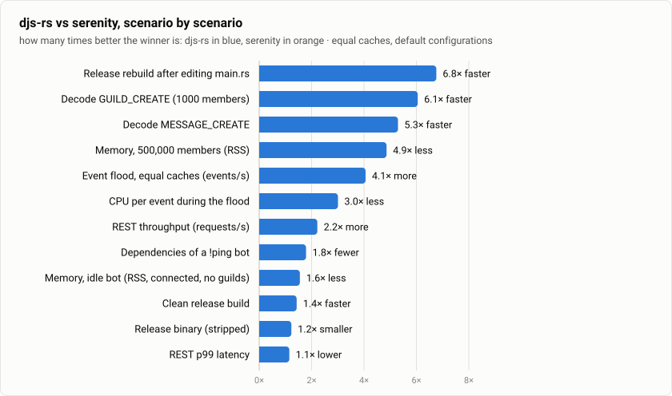

<div align="center">


# djs-rs

**Discord bots in Rust, the way discord.js writes them, several times faster and leaner.**

[](https://crates.io/crates/djs-rs)
[](https://github.com/kotoanidev/djs-rs/actions/workflows/ci.yml)
[](https://kotoanidev.github.io/djs-rs/)
[](https://kotoanidev.github.io/djs-rs/api/djs_rs/)
[](#status)
[](#license)

[Guide](https://kotoanidev.github.io/djs-rs/) ·
[API reference](https://kotoanidev.github.io/djs-rs/api/djs_rs/) ·
[Examples](crates/djs-rs/examples) ·
[Benchmarks](#how-it-compares) ·
[Coming from discord.js](https://kotoanidev.github.io/djs-rs/coming-from-discord-js.html)

</div>

djs-rs is a library for writing Discord bots in Rust, rebuilt from scratch after the
discord.js v14 ecosystem: a `Client` with events, managers and rich structures, builders,
collectors, a cache, sharding and voice, all with the names a discord.js developer already
knows. Under that familiar API sit low-level crates built for throughput and small memory,
each usable on its own.

```rust,no_run
use djs_rs::prelude::*;

#[tokio::main]
async fn main() -> Result<(), Box<dyn std::error::Error>> {
    let client = Client::builder(std::env::var("DISCORD_TOKEN")?)
        .intents(Intents::GUILDS | Intents::GUILD_MESSAGES | Intents::MESSAGE_CONTENT)
        .build();

    client.on(Events::MessageCreate, |ctx, msg| async move {
        if msg.content == "!ping" {
            msg.reply(&ctx, "Pong!").await?;
        }
        Ok(())
    });

    client.command("ping", |ctx, cmd| async move {
        cmd.reply(&ctx, "Pong!").await?;
        Ok(())
    });

    client.login().await?;
    Ok(())
}
```

## Why djs-rs

- **You already know it.** `client.on(Events::MessageCreate, …)`, `msg.reply`,
  `ctx.guilds().fetch(id)`, `EmbedBuilder`, `SlashCommandBuilder`, collectors,
  `Collection`: discord.js's concepts and names, in Rust. Every public item of the API
  reference names its discord.js counterpart, so its search finds things by their
  discord.js name, and the guide has a
  [migration chapter](https://kotoanidev.github.io/djs-rs/coming-from-discord-js.html).
- **Fast, and measured.** Against discord.js, serenity and twilight on the same machine,
  with the same inputs and the same mock Discord servers ([below](#how-it-compares)): events
  decoded 1.8–6× faster, 1.7–4× the events handled, 2.5–5× less memory for the same cached
  members, 2–10× the REST throughput. Every claim links to a script anyone can re-run.
- **Complete.** Every Discord API v10 type and gateway event, every endpoint a bot uses;
  slash commands,
  components (including Components V2) and modals with routers; collectors; an optional,
  configurable cache; automatic sharding in one process or across many; voice with
  Discord's end-to-end encryption (DAVE).
- **Documented.** A [guide](https://kotoanidev.github.io/djs-rs/) from the first bot to
  sharding and voice, with compiled examples; rustdoc on every public item, with Discord's
  docs page and the discord.js counterpart.
- **Reliable.** 1,200+ tests against mock Discord servers (93 % line coverage),
  extreme-load tests for every crate, fault injection against the gateway and the API, and
  no `unsafe` code in the library.
- **Pay for what you use.** No cache unless you ask for one, features for voice and
  multi-process sharding, and every layer (`djs-rest`, `djs-gateway`, `djs-model`, …) a crate
  of its own.

## Getting started

```toml
[dependencies]
djs-rs = "0.1.0-alpha.1"
tokio = { version = "1", features = ["macros", "rt-multi-thread"] }
```

Then follow [the guide](https://kotoanidev.github.io/djs-rs/getting-started/installation.html):
creating the application in Discord's Developer Portal, the first bot, events, slash
commands, components, the cache, REST, sharding and voice. The repository's
[examples](crates/djs-rs/examples) are complete bots: `ping`, `slash_commands`,
`components`, `moderation`, `advanced`.

Cargo features of `djs-rs`:

| Feature | Default | What it adds |
|---|---|---|
| `zstd-stream` | yes | `zstd-stream` gateway compression (needs a C compiler) |
| `zlib-stream` | no | `zlib-stream` gateway compression, pure Rust |
| `sharding` | no | `djs_rs::sharding`: a `ClusterManager` running the shards in several processes |
| `voice` | no | `djs_rs::voice`: voice channels, audio playback and receiving, with DAVE (needs CMake) |
| `native-roots` | no | trusts the system's certificates besides the bundled ones |

## How it compares

Each comparison runs the same bot on the same laptop, with the same gateway payloads and
REST responses from the same mock Discord servers, both clients pinned to the same CPU
cores, and no network. Each page has the method, every number, and the caveats, including
where the other library does better.

| djs-rs compared with | [discord.js 14](docs/VS_NODE.md) (Node.js 22) | [serenity 0.12](docs/VS_SERENITY.md) | [twilight 0.18](docs/VS_TWILIGHT.md) |
|---|---:|---:|---:|
| Decoding `MESSAGE_CREATE` | **3.8× faster** | **5.3× faster** | **2.0× faster** |
| Decoding `GUILD_CREATE` (1000 members) | **4.7× faster** | **6.1× faster** | **1.8× faster** |
| Events handled, the same data cached | **1.9× more** | **4.1× more** | **1.7× more** |
| Memory, idle bot | **15× less** | **1.6× less** | about the same |
| Memory, 500,000 cached members | **2.5× less** | **4.9× less** | **3.3× less** |
| REST requests per second | **9.6× more** | **2.2× more** | **4.0× more** |
| Rebuild after editing the bot (release) | — | **6.8× faster** | **4.4× faster** |
| Build from scratch (release) | — | **1.4× faster** | twilight 1.1× faster |

In absolute numbers, on a laptop CPU (i7-1355U) in its balanced power profile: djs-rs
decodes a `MESSAGE_CREATE` in 1.5 µs and a 1000-member `GUILD_CREATE` in 0.74 ms; one
gateway connection delivers 225,000–245,000 events per second to a bot's handlers; a
connected bot idles at about 6.5 MiB and caches half a million members in 203 MiB; and
djs-rest sends 227,000–250,000 requests per second on four cores.

<picture>
  <source media="(prefers-color-scheme: dark)" srcset="docs/vs-serenity/summary-dark.svg">
  
</picture>

The library's own measurements, phase by phase (decoding, the gateway, REST, the cache,
builders, collectors, sharding, voice) are in [`docs/PERFORMANCE.md`](docs/PERFORMANCE.md).

## The crates

`djs-rs` is the one bots depend on; it re-exports the others. Each one also works alone.

| Crate | discord.js counterpart | What it is |
|---|---|---|
| [`djs-rs`](crates/djs-rs) | `discord.js` | The client: events, managers, structures, interactions, collectors, sharding |
| [`djs-model`](crates/djs-model) | `discord-api-types` | Every Discord API v10 type, with fast decoding |
| [`djs-rest`](crates/djs-rest) | `@discordjs/rest` | The REST client: every endpoint, rate limits, CDN, OAuth2 |
| [`djs-gateway`](crates/djs-gateway) | `@discordjs/ws` | Gateway shards, compression, the IDENTIFY queue |
| [`djs-cache`](crates/djs-cache) | the managers' caches | A configurable, pluggable in-memory cache |
| [`djs-voice`](crates/djs-voice) | `@discordjs/voice` | Voice: calls, playback, receiving, DAVE |
| [`djs-builders`](crates/djs-builders) | `@discordjs/builders` | Embed, command, component and modal builders, checked |
| [`djs-formatters`](crates/djs-formatters) | `@discordjs/formatters` | Markdown, mentions, timestamps, escaping |
| [`djs-collection`](crates/djs-collection) | `@discordjs/collection` | `Collection`, the ordered map with discord.js's helpers |
| [`djs-util`](crates/djs-util) | `@discordjs/util` | Reserved for shared helpers (empty) |

## Where everything is

| What | Where |
|---|---|
| The guide (mdBook) | [kotoanidev.github.io/djs-rs](https://kotoanidev.github.io/djs-rs/), sources in [`book/`](book), its compiled examples in [`book/code`](book/code) |
| The API reference | [kotoanidev.github.io/djs-rs/api](https://kotoanidev.github.io/djs-rs/api/djs_rs/) (and docs.rs once published) |
| Example bots | [`crates/djs-rs/examples`](crates/djs-rs/examples) |
| How the crates fit together | [`docs/ARCHITECTURE.md`](docs/ARCHITECTURE.md) |
| Every design decision, with its reasons | [`docs/DECISIONS.md`](docs/DECISIONS.md) |
| Benchmarks and extreme-load results | [`docs/PERFORMANCE.md`](docs/PERFORMANCE.md); the benchmarks in `crates/*/benches`, the stress tests in `crates/*/tests/stress*.rs` |
| Comparisons | [discord.js](docs/VS_NODE.md), [serenity](docs/VS_SERENITY.md), [twilight](docs/VS_TWILIGHT.md); their harnesses in [`benches/`](benches) |
| Tests | `crates/*/tests` (integration, against mock servers), unit tests next to the code |
| What changed | [`CHANGELOG.md`](CHANGELOG.md) |
| The plan and the current state | [`ROADMAP.md`](ROADMAP.md), [`PROGRESS.md`](PROGRESS.md) |
| Contributing, security, conduct | [`CONTRIBUTING.md`](CONTRIBUTING.md), [`SECURITY.md`](SECURITY.md), [`CODE_OF_CONDUCT.md`](CODE_OF_CONDUCT.md) |

## Status

djs-rs is in **alpha** (`0.1.0-alpha.1`): it covers Discord's API and runs bots end to end,
but its API may still change between alpha releases; the [changelog](CHANGELOG.md) says
how. It needs Rust 1.89 or newer (edition 2024) and tokio. Bug reports, questions and
feedback on the API are very welcome: [issues](https://github.com/kotoanidev/djs-rs/issues),
[discussions](https://github.com/kotoanidev/djs-rs/discussions).

## License

Licensed under either of

- Apache License, Version 2.0 ([LICENSE-APACHE](LICENSE-APACHE) or <https://www.apache.org/licenses/LICENSE-2.0>)
- MIT license ([LICENSE-MIT](LICENSE-MIT) or <https://opensource.org/licenses/MIT>)

at your option.

Unless you explicitly state otherwise, any contribution intentionally submitted for inclusion
in the work by you, as defined in the Apache-2.0 license, shall be dual licensed as above,
without any additional terms or conditions.

djs-rs is an independent project and is not affiliated with discord.js or Discord Inc.
See [`NOTICE`](NOTICE).
