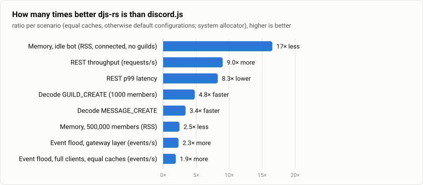

# djs-rs

**A high-performance Rust library for building Discord bots, modelled on discord.js v14.**

> ⚠️ **Status: pre-alpha, under active construction.** Nothing is usable yet. See
> [`ROADMAP.md`](ROADMAP.md) for the plan and [`PROGRESS.md`](PROGRESS.md) for where things stand.

djs-rs rebuilds the discord.js v14 ecosystem from scratch in Rust. The goal is to offer the
familiar discord.js developer experience — `Client`, events, rich structures, managers,
builders, collectors — on top of low-level layers designed for maximum throughput and minimal
memory use, with complete documentation for every public item.

## How it compares with discord.js

Measured on one machine against discord.js 14.28.1 on Node.js 22, with the same inputs and the
same mock Discord servers — [the full results, method and caveats](docs/VS_NODE.md):

<picture>
  <source media="(prefers-color-scheme: dark)" srcset="docs/vs-node/summary-dark.svg">
  
</picture>

## Planned example

```rust,ignore
use djs_rs::prelude::*;

#[tokio::main]
async fn main() -> Result<(), Error> {
    let client = Client::builder(std::env::var("DISCORD_TOKEN")?)
        .intents(Intents::GUILDS | Intents::GUILD_MESSAGES | Intents::MESSAGE_CONTENT)
        .build();

    client.on(Events::MessageCreate, |ctx, msg| async move {
        if msg.content == "!ping" {
            msg.reply(&ctx, "Pong!").await?;
        }
        Ok(())
    });

    client.login().await
}
```

*(The final API may differ in details; it is designed as development progresses.)*

## Crates

djs-rs is a Cargo workspace that mirrors the discord.js monorepo. Use the main crate for the
full experience, or pick individual layers.

| Crate | discord.js counterpart | Purpose |
|---|---|---|
| [`djs-rs`](crates/djs-rs) | `discord.js` | High-level client, events, structures, managers |
| [`djs-model`](crates/djs-model) | `discord-api-types` | Every Discord API v10 type |
| [`djs-rest`](crates/djs-rest) | `@discordjs/rest` | REST client with rate limiting |
| [`djs-gateway`](crates/djs-gateway) | `@discordjs/ws` | Gateway connection and sharding |
| [`djs-cache`](crates/djs-cache) | *(part of discord.js)* | Configurable in-memory cache |
| [`djs-builders`](crates/djs-builders) | `@discordjs/builders` | Embed, command and component builders |
| [`djs-collection`](crates/djs-collection) | `@discordjs/collection` | `Collection` map type |
| [`djs-formatters`](crates/djs-formatters) | `@discordjs/formatters` | Markdown, mention and timestamp helpers |
| [`djs-util`](crates/djs-util) | `@discordjs/util` | Shared utilities |
| `djs-voice` *(later)* | `@discordjs/voice` | Voice connections |

## Design highlights

- **Layered like discord.js:** idiomatic, zero-overhead low-level crates; a discord.js-style
  high-level API on top.
- **Built for speed:** `hyper` 1.x HTTP, `tokio-websockets` gateway, `zstd-stream` transport
  compression, single-pass `serde_json` decoding (simd-json and sonic-rs were measured and
  brought no gain), configurable cache with `DashMap`.
- **Fully documented:** every public item has rustdoc; docs are built with `-D warnings` in CI.
- **tokio-native**, `rustls` by default (optional `native-tls`).
- **MSRV 1.89**, edition 2024.

All design decisions are recorded in [`docs/DECISIONS.md`](docs/DECISIONS.md).

## Contributing

See [`CONTRIBUTING.md`](CONTRIBUTING.md).

## License

Licensed under either of

- Apache License, Version 2.0 ([LICENSE-APACHE](LICENSE-APACHE) or <https://www.apache.org/licenses/LICENSE-2.0>)
- MIT license ([LICENSE-MIT](LICENSE-MIT) or <https://opensource.org/licenses/MIT>)

at your option.

Unless you explicitly state otherwise, any contribution intentionally submitted for inclusion
in the work by you, as defined in the Apache-2.0 license, shall be dual licensed as above,
without any additional terms or conditions.

djs-rs is an independent project and is not affiliated with discord.js or Discord Inc.
See [`NOTICE`](NOTICE).
