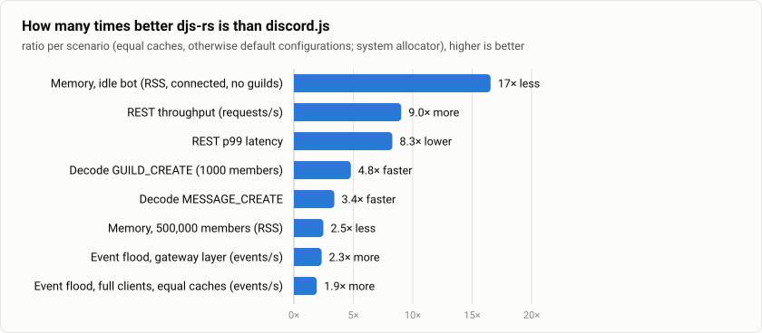
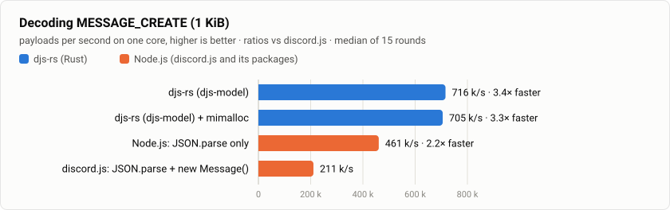
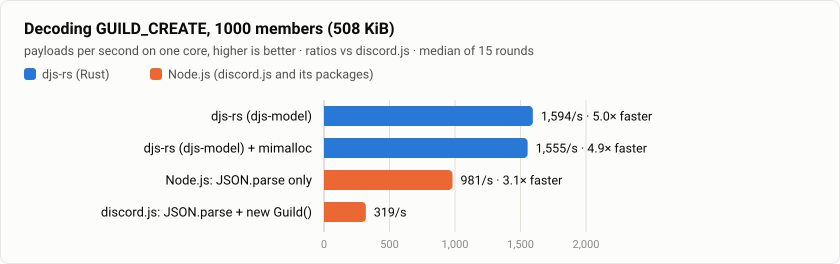
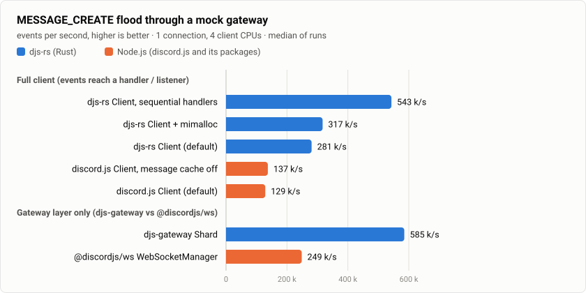
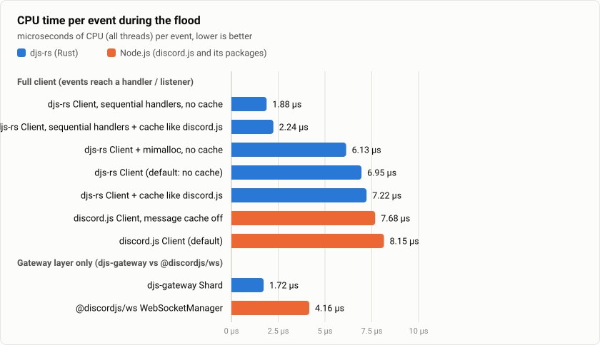
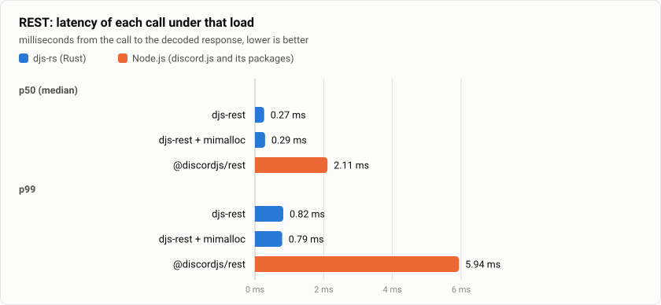

# djs-rs vs discord.js

How much faster and leaner is a Discord bot built on djs-rs than the same bot on
[discord.js](https://discord.js.org) running on Node.js? This page answers it with numbers
measured on one machine, with the same inputs, the same mock Discord servers and the same
measuring code on both sides. Nothing here is estimated: every number comes from
[`benches/vs-node/run.sh`](../benches/vs-node/run.sh), and anyone can re-run it
([Reproduce](#reproduce)).

## At a glance

<!-- vs-node:summary:start -->
<picture>
  <source media="(prefers-color-scheme: dark)" srcset="vs-node/summary-dark.svg">
  
</picture>

| Scenario | djs-rs | discord.js | djs-rs advantage |
| --- | ---: | ---: | ---: |
| Decode `MESSAGE_CREATE` | 1.34 µs | 4.83 µs | **3.6× faster** |
| Decode `GUILD_CREATE` (1000 members) | 627.27 µs | 3.13 ms | **5.0× faster** |
| Event flood, default clients (events/s) | 280,913 | 128,830 | **2.2× more** |
| Event flood, gateway layer (events/s) | 585,180 | 248,519 | **2.4× more** |
| Memory, idle bot (RSS, connected, no guilds) | 5.4 MiB | 102.6 MiB | **19× less** |
| Memory, 500,000 members (RSS) | 183.6 MiB | 504.7 MiB | **2.7× less** |
| REST throughput (requests/s) | 221,159 | 25,642 | **8.6× more** |
| REST p99 latency | 0.82 ms | 5.94 ms | **7.2× lower** |
<!-- vs-node:summary:end -->

In short: a djs-rs bot starts at **about a twentieth of the memory** of a discord.js bot,
decodes Discord's events **3.6–5× faster**, needs **2.7–4.7× less memory** for the same
guilds and members, and its REST client pushes **8.6× more requests** through one machine
with **7× lower tail latency**. The details, the exact configurations and the caveats follow.

## How it is measured

- **The same input, byte for byte.** Every gateway payload and REST response comes from one
  generator ([`src/payloads.rs`](../benches/vs-node/src/payloads.rs)) shaped like what
  Discord sends to bots: full member and user objects, roles, channels with permission
  overwrites, emojis. Every ID is unique, so neither library can deduplicate data that real
  Discord would send as distinct objects.
- **The same mock Discord.** The mock gateway and the mock HTTP API are a separate Rust
  process pinned to their own CPU cores, so they never compete with the client under test.
  Their CPU use is recorded for every run (`server_cpu_ms` in
  [`results.json`](../benches/vs-node/results.json)) to show they were not the bottleneck.
- **The same clients' CPUs.** Every client — Rust or Node.js — runs pinned to the same four
  CPU threads. Single-threaded decode loops run on one pinned core.
- **The same metrics.** CPU time (user + system, all threads) and resident memory (`VmRSS`,
  peak `VmHWM`) are read from `/proc` by identical code in
  [`metrics.rs`](../benches/vs-node/src/metrics.rs) and
  [`common.mjs`](../benches/vs-node/node/common.mjs); the decode timing loop (1 s warm-up,
  15 rounds of ≈ 200 ms, median) is the same on both sides.
- **Default configurations.** djs-rs as a bot gets it by default (system allocator,
  `#[tokio::main]` multi-threaded runtime, `HandlerMode::Concurrent`), and discord.js with its
  defaults (it caches the last 200 messages per channel). Variants — mimalloc, sequential
  handlers, discord.js without the message cache — are listed separately and named as such.
- **The same transport.** The gateway connection is uncompressed for both (discord.js only
  compresses when the optional `zlib-sync` package is installed; djs-rs' default
  `zstd-stream` is turned off), over loopback.
- **Pinned versions.** discord.js and its packages are pinned in
  [`package.json`](../benches/vs-node/package.json) with a committed lockfile and installed
  with `npm ci`.

## 1. Decoding gateway events

How long it takes to turn the JSON text of a gateway event into the library's objects — the
work behind every event a bot receives.

- **djs-rs** decodes into fully typed structures (`djs_model::gateway::GatewayEvent`): IDs
  become integers, timestamps are parsed, enums and flags are checked, unknown fields are
  skipped.
- **discord.js** runs `JSON.parse` and builds the structures its event handlers build
  (`new Message(client, data)` with the message's guild and channel in the cache;
  `new Guild(client, data)`, with the client-wide user and channel caches emptied after each
  call so every call builds its users and channels from scratch, as on a real first
  `GUILD_CREATE`).
- **JSON.parse only** is the floor for any Node.js library: V8's native parser producing
  untyped objects, without any discord.js code.

<!-- vs-node:decode:start -->
<picture>
  <source media="(prefers-color-scheme: dark)" srcset="vs-node/decode-message-dark.svg">
  
</picture>

<picture>
  <source media="(prefers-color-scheme: dark)" srcset="vs-node/decode-guild-dark.svg">
  
</picture>

| Payload | Implementation | Time per payload | Payloads/s | vs discord.js |
| --- | ---: | ---: | ---: | ---: |
| `MESSAGE_CREATE` | djs-rs (djs-model) | 1.34 µs | 746,829 | **3.6×** |
| `MESSAGE_CREATE` | djs-rs (djs-model) + mimalloc | 1.39 µs | 720,718 | **3.5×** |
| `MESSAGE_CREATE` | Node.js: JSON.parse only | 2.11 µs | 473,600 | **2.3×** |
| `MESSAGE_CREATE` | discord.js: JSON.parse + new Message() | 4.83 µs | 207,161 | baseline |
| `GUILD_CREATE` | djs-rs (djs-model) | 627.27 µs | 1,594 | **5.0×** |
| `GUILD_CREATE` | djs-rs (djs-model) + mimalloc | 643.28 µs | 1,555 | **4.9×** |
| `GUILD_CREATE` | Node.js: JSON.parse only | 1.02 ms | 981 | **3.1×** |
| `GUILD_CREATE` | discord.js: JSON.parse + new Guild() | 3.13 ms | 319 | baseline |
<!-- vs-node:decode:end -->

- djs-rs decodes into strict Rust types **faster than V8's native `JSON.parse` can build
  untyped JavaScript objects** (1.6× faster for both payloads) — before discord.js has done
  any of its own work. discord.js then spends more than half of its time
  building its structures on top.
- The gap grows with the payload: large `GUILD_CREATE`s (5×) are where Rust's compact,
  allocation-light types pay off most.

## 2. Event flood through a gateway

A bot connects to the mock gateway, which sends `READY`, one 1000-member `GUILD_CREATE` with
the channel, and then a flood of `MESSAGE_CREATE` events (authors cycling through the
members) as fast as the client reads them. The window runs from the first event that reaches
the bot's code to the last; CPU time is that of the whole client process in the window.

- **Full client:** a djs-rs `Client` with one `Events::MessageCreate` handler vs a discord.js
  `Client` with one `messageCreate` listener.
- **Gateway layer only:** the libraries the clients are built on — a djs-gateway `Shard`
  yielding typed events vs an @discordjs/ws `WebSocketManager` emitting parsed JSON.

<!-- vs-node:flood:start -->
<picture>
  <source media="(prefers-color-scheme: dark)" srcset="vs-node/flood-throughput-dark.svg">
  
</picture>

<picture>
  <source media="(prefers-color-scheme: dark)" srcset="vs-node/flood-cpu-dark.svg">
  
</picture>

| Layer | Implementation | Events/s | vs Node.js | CPU per event | vs Node.js | Peak RSS |
| --- | ---: | ---: | ---: | ---: | ---: | ---: |
| full client | djs-rs Client, sequential handlers | 542,949 | **4.2×** | 1.81 µs | **4.6×** less | 7.1 MiB |
| full client | djs-rs Client + mimalloc | 317,063 | **2.5×** | 5.91 µs | **1.4×** less | 20.5 MiB |
| full client | djs-rs Client (default) | 280,913 | **2.2×** | 6.74 µs | **1.2×** less | 8.2 MiB |
| full client | discord.js Client, message cache off | 137,248 | **1.1×** | 7.68 µs | **1.1×** less | 127.6 MiB |
| full client | discord.js Client (default) | 128,830 | baseline | 8.30 µs | baseline | 127.7 MiB |
| gateway layer | djs-gateway Shard | 585,180 | **2.4×** | 1.69 µs | **2.4×** less | 6.9 MiB |
| gateway layer | @discordjs/ws WebSocketManager | 248,519 | baseline | 4.10 µs | baseline | 131.2 MiB |
<!-- vs-node:flood:end -->

- **Full client, default configurations: 2.2× the throughput** of discord.js and 16× less
  peak memory (8 MiB vs 128 MiB) while doing it.
- **The gateway layers alone: 2.4× the throughput at 2.4× less CPU per event** — and the
  djs-gateway `Shard` delivers fully typed events, while @discordjs/ws delivers parsed JSON
  that discord.js still has to turn into structures.
- **An honest weak spot:** djs-rs' default `HandlerMode::Concurrent` runs every handler call
  in its own tokio task. Under a flood on a multi-threaded runtime, each spawn wakes an idle
  worker thread, so the default client burns **6.7 µs of CPU per event — barely less than
  discord.js (8.3 µs)**, even though it delivers 2.2× the events. With
  `HandlerMode::Sequential` (handlers run in event order on the shard's task, which suits
  fast handlers) the same client handles **4.2× the events of discord.js at 4.6× less CPU per
  event**. Making the concurrent mode as cheap is an open optimization item.
- discord.js barely gains from turning its message cache off (1.07×): its cost is in the
  event pipeline and structure building, not in the cache.

## 3. Memory of the guilds a bot receives

At startup Discord sends a `GUILD_CREATE` for every guild of the bot; with the guild members
intent it contains the members. The mock gateway sends 100 or 500 guilds of 1000 members each
(plus 20 channels, 10 roles and 20 emojis per guild), and the resident memory of the process
is read once all have arrived. "Connected, no guilds" is the idle footprint.

- **discord.js** keeps everything in its default caches (guilds, members, users, channels,
  roles, emojis); the garbage collector runs before measuring.
- **djs-rs has no cache layer yet** (it is Phase 5 of the [roadmap](../ROADMAP.md)), so the
  bot here keeps every decoded guild — the complete typed model, including every member and
  user — in a `HashMap`. That is all the data a cache would store; the future `djs-cache` can
  only store the same or less (it will let a bot skip what it does not need).

<!-- vs-node:memory:start -->
<picture>
  <source media="(prefers-color-scheme: dark)" srcset="vs-node/memory-dark.svg">
  
</picture>

| Guilds | Implementation | RSS | vs discord.js | RSS added per member | JS heap used |
| --- | ---: | ---: | ---: | ---: | ---: |
| connected, no guilds | djs-rs | 5.4 MiB | **19×** less | — | — |
| connected, no guilds | djs-rs + mimalloc | 11.4 MiB | **9.0×** less | — | — |
| connected, no guilds | discord.js Client (default caches) | 102.6 MiB | baseline | — | 16.7 MiB |
| 100 guilds · 100,000 members | djs-rs | 41.8 MiB | **4.7×** less | 383 B | — |
| 100 guilds · 100,000 members | djs-rs + mimalloc | 54.3 MiB | **3.6×** less | 448 B | — |
| 100 guilds · 100,000 members | discord.js Client (default caches) | 196.0 MiB | baseline | 990 B | 91.5 MiB |
| 500 guilds · 500,000 members | djs-rs | 183.6 MiB | **2.7×** less | 373 B | — |
| 500 guilds · 500,000 members | djs-rs + mimalloc | 208.4 MiB | **2.4×** less | 413 B | — |
| 500 guilds · 500,000 members | discord.js Client (default caches) | 504.7 MiB | baseline | 847 B | 382.6 MiB |
<!-- vs-node:memory:end -->

- **Idle, a connected djs-rs bot is 5.4 MiB; a discord.js bot is 103 MiB** before it has
  received a single guild — the price of the V8 engine, the Node.js runtime and the library
  code loaded at startup. For bots run in containers or on small VPSes this is the most
  visible difference.
- **Per member, djs-rs keeps 373–383 bytes and discord.js 847–990 bytes** (RSS, after a
  full garbage collection on the Node.js side). At 500,000 members that is 184 MiB vs
  505 MiB.
- mimalloc trades some memory for speed here (it keeps per-thread free lists); the system
  allocator is the leaner choice for memory-bound bots.

## 4. REST throughput

64 concurrent workers call Create Message (`POST /channels/{id}/messages`) against the mock
HTTP API, each in its own channel so that every request has its own rate-limit bucket; the
mock answers with a message and rate-limit headers that never run out. The proactive global
limit (50 requests per second by default in both libraries, like Discord's) is lifted in both,
so what is measured is the client's own overhead: building the request, the rate limiter,
HTTP and decoding the response (typed `Message` in djs-rest, parsed JSON in @discordjs/rest).
A warm-up round opens the connections first.

<!-- vs-node:rest:start -->
<picture>
  <source media="(prefers-color-scheme: dark)" srcset="vs-node/rest-throughput-dark.svg">
  
</picture>

<picture>
  <source media="(prefers-color-scheme: dark)" srcset="vs-node/rest-latency-dark.svg">
  
</picture>

| Implementation | Requests/s | vs Node.js | p50 | p99 | CPU per request | Peak RSS |
| --- | ---: | ---: | ---: | ---: | ---: | ---: |
| djs-rest | 221,159 | **8.6×** | 0.27 ms | 0.82 ms | 14.7 µs | 12.8 MiB |
| djs-rest + mimalloc | 206,534 | **8.1×** | 0.29 ms | 0.79 ms | 15.8 µs | 31.8 MiB |
| @discordjs/rest | 25,642 | baseline | 2.11 ms | 5.94 ms | 49.9 µs | 211.3 MiB |
<!-- vs-node:rest:end -->

- **8.6× the requests per second at 3.4× less CPU per request, with 7× lower p99 latency**
  and a 16× smaller memory footprint.
- The mock API was given eight CPU threads and used 3.7 of them on average during the djs-rest
  runs (0.45 during the @discordjs/rest runs), so it was not saturated; the djs-rest figure
  is, if anything, a lower bound.
- Against the real Discord API the global rate limit caps a bot long before either library
  is busy; what carries over is the CPU each request costs (14.7 µs vs 49.9 µs) and the
  memory the client needs.

## What these numbers do and do not mean

- **They measure the libraries, not Discord.** Over the internet, TLS and network latency
  dominate REST latency, and Discord's rate limits cap how many requests a bot may send. The
  numbers show the headroom a library leaves: how many events or requests one CPU core can
  handle, how much memory a large bot needs and how long a slow moment lasts.
- **One machine.** A laptop CPU with frequency scaling; repeated runs vary by a few percent
  (each configuration's range is in `results.json`). The ratios are stable across runs; the
  absolute numbers depend on the machine.
- **Same work, different guarantees.** djs-rs validates and types every field it decodes;
  discord.js builds rich JavaScript objects. Neither shortcut is taken on either side.
- **What is not compared.** Features djs-rs does not have yet — the cache layer, automatic
  sharding, the high-level structures beyond messages — are not part of this comparison.
  The page will grow as they land.

## Reproduce

On Linux with Rust (stable), Node.js 22+ and npm:

```bash
benches/vs-node/run.sh            # ≈ 5 minutes, 3 runs per configuration
RUNS=1 benches/vs-node/run.sh     # quicker, noisier
```

The script builds the harness, installs the pinned npm packages with `npm ci`, runs every
scenario and rewrites the tables and charts on this page and
[`results.json`](../benches/vs-node/results.json). The CPU pinning
(`CLIENT_CPUS`, `SERVER_CPUS`, `DECODE_CPU`) defaults to this machine's layout; set them to
match yours. `node benches/vs-node/node/report.mjs` re-renders the page from `results.json`
alone. [`benches/vs-node/README.md`](../benches/vs-node/README.md) describes the harness.

## Environment

<!-- vs-node:environment:start -->
|  |  |
| --- | ---: |
| Date | 2026-11-11 |
| CPU | 13th Gen Intel(R) Core(TM) i7-1355U (12 threads), 15 GiB RAM |
| OS | Linux 7.3.3-200.fc44.x86_64 |
| Rust | `rustc 1.99.1 (58cf8f9c3 2026-10-13)`, release profile (`lto = "fat"`, `codegen-units = 1`) |
| Node.js | v22.23.1, discord.js 14.28.1, @discordjs/ws 1.2.3, @discordjs/rest 2.6.3 |
| CPU pinning | clients on CPUs 0-3, mock servers on CPUs 4-11, decode loops on CPU 2 |
| Runs | 3 per configuration (the median run is shown; decode: median of 15 rounds) |
<!-- vs-node:environment:end -->
