# djs-rs vs serenity

[serenity](https://github.com/serenity-rs/serenity) is a long-standing, widely used Discord
library for Rust. This page compares a bot built on djs-rs with the same bot built on serenity
0.12.5, in its default features and configuration, on **performance, resources and
reliability**. The numbers were measured on one machine, with the same inputs and the same
mock Discord servers for both libraries. Ease of use and API coverage are not compared here
(D-279). Every number comes from the scripts in
[`benches/vs-serenity`](../benches/vs-serenity/README.md), and anyone can re-run them
([Reproduce](#reproduce)). Where serenity does better, this page says so.

## At a glance

### Performance and resources

<!-- vs-serenity:summary:start -->
<picture>
  <source media="(prefers-color-scheme: dark)" srcset="vs-serenity/summary-dark.svg">
  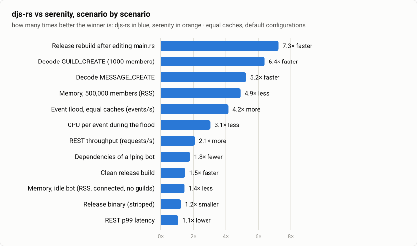
</picture>

| Scenario | djs-rs | serenity | Result |
| --- | ---: | ---: | ---: |
| Decode `MESSAGE_CREATE` | 1.61 µs | 7.94 µs | **4.9× faster** |
| Decode `GUILD_CREATE` (1000 members) | 731.86 µs | 4.51 ms | **6.2× faster** |
| Event flood, equal caches (events/s) | 243,081 | 61,228 | **4.0× more** |
| CPU per event during the flood | 7.70 µs | 22.6 µs | **2.9× less** |
| Memory, idle bot (RSS, connected, no guilds) | 6.6 MiB | 10.0 MiB | **1.5× less** |
| Memory, 500,000 members (RSS) | 203.5 MiB | 998.4 MiB | **4.9× less** |
| REST throughput (requests/s) | 255,872 | 114,124 | **2.2× more** |
| REST p99 latency | 0.54 ms | 0.63 ms | **1.1× lower** |
| Dependencies of a `!ping` bot | 85 | 152 | **1.8× fewer** |
| Clean release build | 46.6 s | 73.7 s | **1.6× faster** |
| Release rebuild after editing `main.rs` | 9.91 s | 4.95 s | serenity **2.0× faster** |
| Release binary (stripped) | 8.7 MiB | 10.8 MiB | **1.2× smaller** |
<!-- vs-serenity:summary:end -->

### Reliability

The same bot, the same faults injected by a mock gateway and a mock API. The details are in
sections [6](#6-reliability-gateway-faults) and [7](#7-reliability-api-faults).

<!-- vs-serenity:reliability-summary:start -->
| Fault | djs-rs | serenity |
| --- | ---: | ---: |
| Connection dropped (no close frame) | resumed after 3.0 ms, nothing lost | resumed after 2.9 ms, nothing lost |
| Opcode 7 `RECONNECT` | resumed after 2.2 ms, nothing lost | resumed after 3.8 ms, nothing lost |
| Opcode 9 `INVALID_SESSION`, not resumable | new session after 3.10 s, 3,101 events lost | new session after 5.00 s, 5,003 events lost |
| Zombie connection (no heartbeat ACK) | resumed after 1.77 s, nothing lost | new session after 6.02 s, 6,016 events lost |
| Close code 4000 (resumable) | resumed after 2.7 ms, nothing lost | resumed after 3.0 ms, nothing lost |
| Close code 4004 (authentication failed) | stopped with an error, did not reconnect | stopped with an error, did not reconnect |
| Route 429, `retry_after` 0.5 s | 40/40 sent, waited 552 ms, none early | 40/40 sent, waited 1.00 s, none early |
| Global 429, `retry_after` 0.5 s | 40/40 sent, waited 552 ms, none early | 40/40 sent, waited 1.00 s, none early |
| 502 on the first attempt at every 4th message | 40/40 sent, 8 retried | 32/40 sent, 8 failed (no retry) |
<!-- vs-serenity:reliability-summary:end -->

In short: with the same data cached, a djs-rs bot decodes Discord's events **4.9–6.2×
faster** than a serenity bot. It handles **4× the events at about a third of the CPU**. It
starts in **1.5× less memory** and needs **4.9× less** for half a million cached members. Its
REST client sends **2.2× more requests**, and still 1.6× more when serenity's TLS and rate
limiter are taken out. A djs-rs bot pulls in 85 crates instead of 152, builds from scratch
1.6× faster, and its binary is 1.2× smaller. **serenity rebuilds a bot about twice as fast
after an edit.** That is the one place where serenity is ahead, and djs-rs has work to do
there.

Under faults, both libraries handle a dropped connection, `RECONNECT` and the close codes
correctly. djs-rs resumes a zombie connection without losing an event, while serenity starts
a new session and loses everything sent meanwhile. djs-rs retries a 502 where serenity gives
up, and it waits out a half-second rate limit in about half the time.

## How it is measured

- **The same input, byte for byte.** Every gateway payload and REST response comes from the
  generator of [`docs/VS_NODE.md`](VS_NODE.md)
  ([`payloads.rs`](../benches/vs-node/src/payloads.rs)). It is shaped like what Discord
  sends to bots, and every ID is unique.
- **The same mock Discord.** The mock gateway and the mock HTTP API run as separate
  processes pinned to their own CPU cores, so they never compete with the client under
  test. Their CPU use is recorded for every run (`server_cpu_ms` in
  [`results.json`](../benches/vs-serenity/results.json)).
- **How serenity reaches the mocks (D-282).** serenity's HTTP client keeps its
  `https://discord.com` URLs: its default rate limiter ignores the proxy setting. So the
  harness gives serenity a `reqwest` client that resolves `discord.com` to an **HTTPS** mock
  and trusts only a certificate authority made for the run. djs-rs takes the mock's URL and
  talks plain HTTP. serenity therefore pays for TLS in the REST runs. The REST section also
  shows serenity with its rate limiter disabled over plain HTTP (its documented proxy
  setup) as a bound: what serenity could do without TLS. The gateway runs are plain
  WebSocket for both libraries.
- **The same CPUs and metrics.** Both clients run pinned to the same four CPU threads, and
  single-threaded decode loops to one core. CPU time and resident memory are read from
  `/proc` by the same code ([`metrics.rs`](../benches/vs-node/src/metrics.rs)).
- **Equal caches, otherwise default configurations (D-280, C-109).** serenity caches guilds
  with their members, roles, emojis, stickers, channels, threads, presences, voice states,
  stage instances and scheduled events, plus users, and no messages by default. The djs-rs
  `Client` is given a cache with the same contents. djs-rs without a cache, its own
  default, is shown as a variant.
- **Equally optimized.** The djs-rs runners and the serenity runners are built with the same
  release profile (`lto = "fat"`, `codegen-units = 1`). The two bots of the build section
  use the default profiles of a new project.
- **No network.** Every run happens in a network namespace with only a loopback interface,
  so nothing can reach Discord, even by mistake (C-108).

## 1. Decoding gateway events

How long it takes to turn one gateway payload (JSON text) into the library's typed event, on
one CPU core: djs-rs decodes into `djs-model` types, serenity into its `GatewayEvent`, as
their shards do. `MESSAGE_CREATE` is the most frequent event of a busy bot. `GUILD_CREATE`
carries a whole guild at startup, here with 1000 members.

<!-- vs-serenity:decode:start -->
<picture>
  <source media="(prefers-color-scheme: dark)" srcset="vs-serenity/decode-message-dark.svg">
  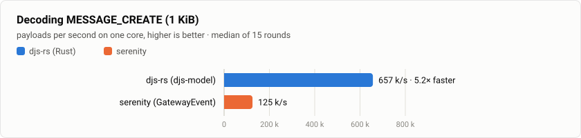
</picture>

<picture>
  <source media="(prefers-color-scheme: dark)" srcset="vs-serenity/decode-guild-dark.svg">
  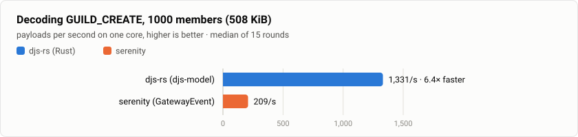
</picture>

| Payload | Implementation | Time per payload | Payloads/s | vs serenity |
| --- | ---: | ---: | ---: | ---: |
| `MESSAGE_CREATE` | djs-rs (djs-model) | 1.61 µs | 620,341 | **4.9× faster** |
| `MESSAGE_CREATE` | serenity (GatewayEvent) | 7.94 µs | 125,977 | baseline |
| `GUILD_CREATE` | djs-rs (djs-model) | 731.86 µs | 1,366 | **6.2× faster** |
| `GUILD_CREATE` | serenity (GatewayEvent) | 4.51 ms | 222 | baseline |
<!-- vs-serenity:decode:end -->

- One core decodes 620,000 `MESSAGE_CREATE`s per second with djs-rs and 126,000 with
  serenity. A 1000-member `GUILD_CREATE` takes 0.73 ms against 4.51 ms.
- serenity's optional `simd_json` decoder is not used: both libraries run with their default
  features (D-280).

## 2. Event flood through a gateway

The mock gateway sends `MESSAGE_CREATE` events as fast as one connection allows. Each event
reaches a handler of the bot (`client.on(Events::MessageCreate, …)` in djs-rs, an
`EventHandler::message` in serenity), and the cache stores what it keeps from it.

<!-- vs-serenity:flood:start -->
<picture>
  <source media="(prefers-color-scheme: dark)" srcset="vs-serenity/flood-throughput-dark.svg">
  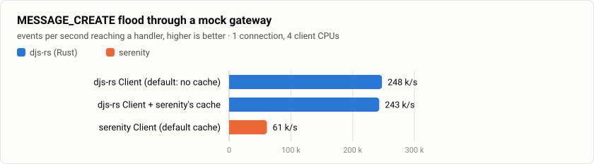
</picture>

<picture>
  <source media="(prefers-color-scheme: dark)" srcset="vs-serenity/flood-cpu-dark.svg">
  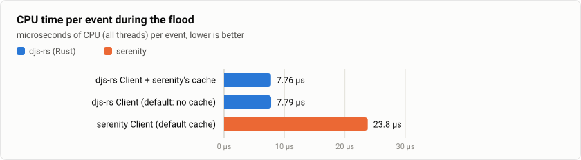
</picture>

| Implementation | Events/s (range) | vs serenity | CPU per event | vs serenity | Peak RSS |
| --- | ---: | ---: | ---: | ---: | ---: |
| djs-rs Client (default: no cache) | 247,507 (247,241–247,563) | **4.0× more** | 7.65 µs | **3.0× less** | 9.0 MiB |
| djs-rs Client + serenity's cache | 243,081 (240,598–245,202) | **4.0× more** | 7.70 µs | **2.9× less** | 8.8 MiB |
| serenity Client (default cache) | 61,228 (60,410–64,461) | baseline | 22.6 µs | baseline | 19.7 MiB |
<!-- vs-serenity:flood:end -->

- djs-rs delivers **4.0× the events per second** with serenity's cache and spends **2.9×
  less CPU per event** (7.7 µs against 22.6 µs). Its memory peaks at less than half of
  serenity's (8.8 against 19.7 MiB).
- Keeping serenity's cache costs djs-rs 2 % of its throughput (243,081 against 247,507
  events/s without a cache).
- The mock gateway used about one CPU-second per run for either library, so it was never
  the limit.

## 3. Memory of the guilds a bot receives

The bot connects, receives guilds of 1000 members each (members, roles, channels, emojis,
presences) and caches them. Resident memory is measured once every guild is cached.

<!-- vs-serenity:memory:start -->
<picture>
  <source media="(prefers-color-scheme: dark)" srcset="vs-serenity/memory-dark.svg">
  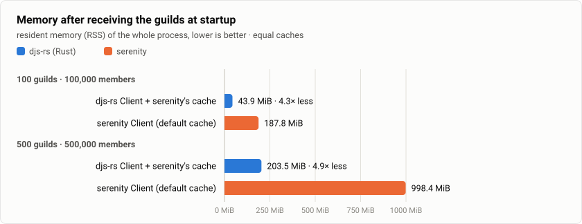
</picture>

| Guilds | Implementation | RSS | vs serenity | RSS added per member |
| --- | ---: | ---: | ---: | ---: |
| connected, no guilds | djs-rs Client + serenity's cache | 6.6 MiB | **1.5× less** | — |
| connected, no guilds | serenity Client (default cache) | 10.0 MiB | baseline | — |
| 100 guilds · 100,000 members | djs-rs Client + serenity's cache | 43.9 MiB | **4.3× less** | 391 B |
| 100 guilds · 100,000 members | serenity Client (default cache) | 187.8 MiB | baseline | 1,865 B |
| 500 guilds · 500,000 members | djs-rs Client + serenity's cache | 203.5 MiB | **4.9× less** | 412 B |
| 500 guilds · 500,000 members | serenity Client (default cache) | 998.4 MiB | baseline | 2,072 B |
<!-- vs-serenity:memory:end -->

- Connected with no guilds, a djs-rs bot uses 6.6 MiB and a serenity bot 10.0 MiB.
- Each cached member adds about 0.4 KB with djs-rs and about 2 KB with serenity, including
  the guild's share of roles, channels and presences. So the gap grows with the bot: 4.3× at
  100,000 members and 4.9× at 500,000, where serenity needs nearly 1 GiB.

## 4. REST throughput

64 concurrent workers call Create Message (`POST /channels/{id}/messages`) against the mock
HTTP API, each in its own channel so that every request has its own rate-limit bucket. The
mock answers with a message and rate-limit headers that never run out. djs-rs's proactive
global limit (50 requests per second by default, like Discord's) is lifted; serenity has
none. So what is measured is the client's own overhead: building the request, the rate
limiter, HTTP and decoding the response into a typed `Message`.

<!-- vs-serenity:rest:start -->
<picture>
  <source media="(prefers-color-scheme: dark)" srcset="vs-serenity/rest-throughput-dark.svg">
  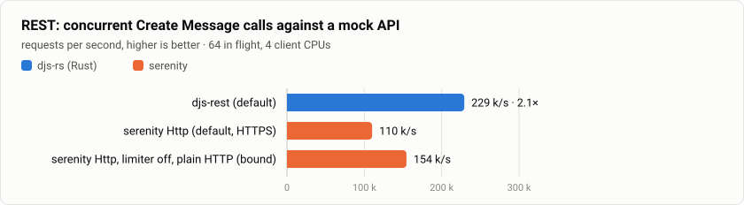
</picture>

<picture>
  <source media="(prefers-color-scheme: dark)" srcset="vs-serenity/rest-latency-dark.svg">
  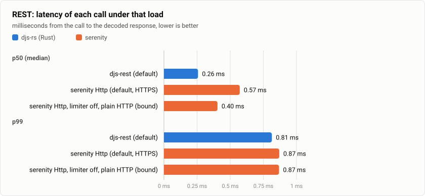
</picture>

| Implementation | Requests/s | vs serenity default | p50 | p99 | CPU per request | Peak RSS |
| --- | ---: | ---: | ---: | ---: | ---: | ---: |
| djs-rest (default) | 255,872 | **2.2× more** | 0.24 ms | 0.54 ms | 13.7 µs | 12.6 MiB |
| serenity Http (default, HTTPS) | 114,124 | baseline | 0.56 ms | 0.63 ms | 27.7 µs | 17.9 MiB |
| serenity Http, limiter off, plain HTTP (bound) | 159,421 | 1.4× the default | 0.40 ms | 0.80 ms | 23.2 µs | 14.5 MiB |
<!-- vs-serenity:rest:end -->

- djs-rs sends **2.2× the requests per second** of serenity's default configuration, at
  half the CPU per request (13.7 against 27.7 µs) and with a lower p99 (0.54 against
  0.63 ms).
- Part of that gap is TLS, which only serenity pays here (D-282). Without TLS and without
  its rate limiter, serenity reaches 159,421 requests/s. djs-rs, with its rate limiter
  working, still sends 1.6× more at 1.7× less CPU per request, and in that bound serenity's
  p99 rises to 0.80 ms.
- Against the real Discord both libraries use TLS, and the global rate limit caps a bot long
  before either library is busy. What carries over is the CPU and memory each request
  costs.

## 5. Building a bot

The same `!ping` → `Pong!` bot ([`bots/djs-rs`](../benches/vs-serenity/bots/djs-rs/src/main.rs),
[`bots/serenity`](../benches/vs-serenity/bots/serenity/src/main.rs)), each in a project of
its own with default features, built with `cargo build` from an empty target directory on
every CPU. The second time is the rebuild after editing `main.rs`, which a bot author waits
for on every change.

<!-- vs-serenity:build:start -->
<picture>
  <source media="(prefers-color-scheme: dark)" srcset="vs-serenity/build-time-dark.svg">
  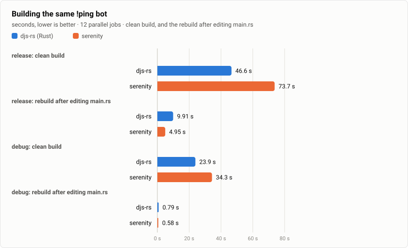
</picture>

<picture>
  <source media="(prefers-color-scheme: dark)" srcset="vs-serenity/binary-size-dark.svg">
  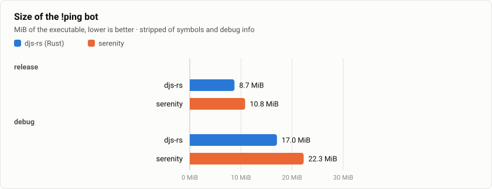
</picture>

| Profile | Bot | Clean build (range) | Rebuild (range) | Binary | Stripped |
| --- | ---: | ---: | ---: | ---: | ---: |
| release | djs-rs | 46.6 s (46.6 s–46.8 s) | 9.91 s (9.91 s–9.92 s) | 12.2 MiB | 8.7 MiB |
| release | serenity | 73.7 s (73.7 s–74.1 s) | 4.95 s (4.95 s–5.01 s) | 14.7 MiB | 10.8 MiB |
| debug | djs-rs | 23.9 s (23.9 s–25.0 s) | 0.79 s (0.79 s–1.38 s) | 136.8 MiB | 17.0 MiB |
| debug | serenity | 34.3 s (34.3 s–35.2 s) | 0.58 s (0.58 s–0.61 s) | 131.9 MiB | 22.3 MiB |

| Bot | Dependencies (normal, this platform) |
| --- | ---: |
| djs-rs | 85 |
| serenity | 152 |
<!-- vs-serenity:build:end -->

- A djs-rs bot depends on 85 crates and a serenity bot on 152. From an empty target
  directory, djs-rs builds in 46.6 s (release) and 23.9 s (debug), serenity in 73.7 s and
  34.3 s. The djs-rs release binary is smaller: 8.7 against 10.8 MiB stripped.
- **serenity rebuilds faster after an edit:** 4.95 s against 9.91 s in release, and 0.58 s
  against 0.79–1.38 s in debug. A rebuild recompiles the bot's own crate, and with djs-rs
  that crate holds more code. A likely cause is that djs-rs's `Client` and its handlers are
  generic, so they are compiled and optimized in the bot's crate rather than in the
  library's. This still has to be measured. It is recorded as an open question in
  [`DECISIONS.md`](DECISIONS.md), because it is the wait a bot author feels on every edit.

## 6. Reliability: gateway faults

A mock gateway models a Discord session. Once the bot has identified, Discord produces one
numbered `MESSAGE_CREATE` per millisecond for the session, whether a connection is open or
not. A connection gets what its session has not sent yet. `RESUME` replays what the client
missed. A new `IDENTIFY` starts a new session, and whatever the old session never
delivered is lost, as on Discord. After 2000 messages the fault happens, and 8000 more
follow. The bot counts the numbers it receives, so every lost or duplicated event is
visible. The time without events is measured by the mock, on the same clock for both
libraries.

<!-- vs-serenity:gateway:start -->
<picture>
  <source media="(prefers-color-scheme: dark)" srcset="vs-serenity/gateway-recovery-dark.svg">
  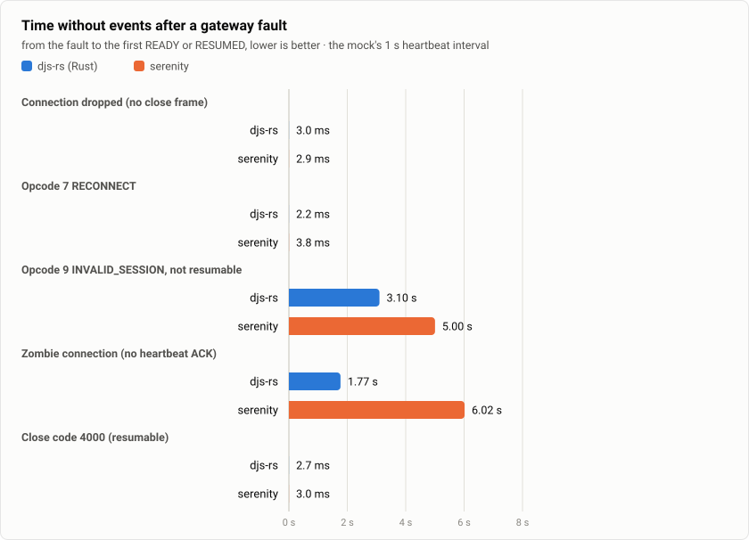
</picture>

<picture>
  <source media="(prefers-color-scheme: dark)" srcset="vs-serenity/gateway-lost-dark.svg">
  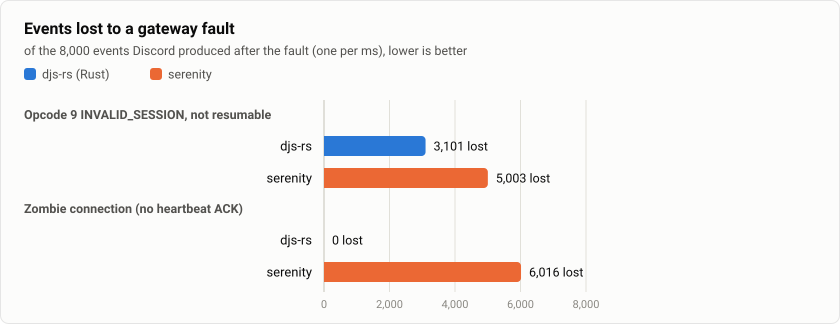
</picture>

| Fault | Library | Recovery | Without events (range) | Lost | Duplicated | Replayed by RESUME |
| --- | ---: | ---: | ---: | ---: | ---: | ---: |
| Connection dropped (no close frame) | djs-rs | resumed | 3.0 ms (2.6 ms–4.1 ms) | 0 | 0 | 2 |
| Connection dropped (no close frame) | serenity | resumed | 2.9 ms (2.6 ms–4.3 ms) | 0 | 0 | 2 |
| Opcode 7 `RECONNECT` | djs-rs | resumed | 2.2 ms (1.7 ms–2.5 ms) | 0 | 0 | 1 |
| Opcode 7 `RECONNECT` | serenity | resumed | 3.8 ms (3.4 ms–4.0 ms) | 0 | 0 | 1 |
| Opcode 9 `INVALID_SESSION`, not resumable | djs-rs | identified | 3.10 s (3.10 s–3.10 s) | 3,101 | 0 | 0 |
| Opcode 9 `INVALID_SESSION`, not resumable | serenity | identified | 5.00 s (5.00 s–5.01 s) | 5,003 | 0 | 0 |
| Zombie connection (no heartbeat ACK) | djs-rs | resumed | 1.77 s (1.70 s–1.86 s) | 0 | 0 | 1,761 |
| Zombie connection (no heartbeat ACK) | serenity | identified | 6.02 s (6.02 s–6.02 s) | 6,016 | 0 | 0 |
| Close code 4000 (resumable) | djs-rs | resumed | 2.7 ms (2.7 ms–3.0 ms) | 0 | 0 | 2 |
| Close code 4000 (resumable) | serenity | resumed | 3.0 ms (2.8 ms–3.0 ms) | 0 | 0 | 2 |
| Close code 4004 (authentication failed) | djs-rs | stopped | — | 7,999 | 0 | 0 |
| Close code 4004 (authentication failed) | serenity | stopped | — | 8,000 | 0 | 0 |
<!-- vs-serenity:gateway:end -->

- **Dropped connection, `RECONNECT`, close code 4000:** both libraries reconnect within a
  few milliseconds and resume. The mock replays what they missed, and nothing is lost.
- **Close code 4004:** both stop with an authentication error and do not reconnect. That is
  right: retrying cannot fix a bad token.
- **Zombie connection:** the mock keeps the connection open but stops acknowledging
  heartbeats and sending events.
  - djs-rs notices the missing ACK at its next heartbeat, reconnects and resumes. The mock
    replays the events it missed (1,761, median), and nothing is lost.
  - serenity 0.12.5 treats a missing ACK as a reason to restart the shard
    (`ShardRunner::run` → `request_restart`). A restart starts a **new session**, so the
    events of the old one are gone: 6,016 here.
  - The restart also waits up to 5 s for the shard to confirm its shutdown
    (`ShardManager::shutdown`). Since the shard itself asked for the restart, that wait ran
    its full 5 s in every run. serenity was back after 6.0 s, djs-rs after 1.8 s.
- **`INVALID_SESSION`, not resumable:** a new session is the only way back, and the events
  produced meanwhile are lost for any client, by the protocol.
  - Discord asks for a random 1–5 s wait and allows one `IDENTIFY` per 5 s. djs-rs honours
    both. Its first `IDENTIFY` was about 2 s before the fault, so it identified again
    3.1 s after the fault in all three runs. A longer random wait would have set the time
    instead.
  - serenity goes through the same shard restart and its 5 s wait.
  - The shorter the outage, the fewer events lost: 3,101 against 5,003.
- With Discord's real heartbeat interval (about 41 s), either library notices a zombie
  connection one to two intervals late. djs-rs then still loses nothing; serenity loses
  everything sent in that time.

## 7. Reliability: API faults

Four workers send 10 messages each to their own channels through a mock API that fails on
purpose:

- a **route 429**: the first request in each channel is rate limited;
- a **global 429**: the first request of all is rate limited;
- **502 Bad Gateway** as an HTML page, the way a proxy sends it, on the first attempt at
  every 4th message of a channel.

The 429s ask for 0.5 s in the body's `retry_after`. The `Retry-After` header carries whole
seconds, rounded up, as in Discord's examples. The mock records how long each client waited
and whether any request arrived inside the window. A request within 25 ms of the 429 was
already on its way and counts as "in flight". A later one ignored the 429 and counts as
"early".

<!-- vs-serenity:api:start -->
<picture>
  <source media="(prefers-color-scheme: dark)" srcset="vs-serenity/api-wait-dark.svg">
  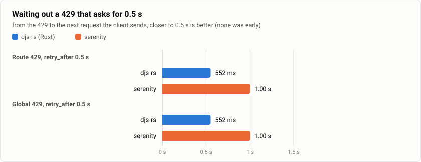
</picture>

| Fault | Library | Sent | Requests received | Wait after the 429 | In flight / early | Error reported |
| --- | ---: | ---: | ---: | ---: | ---: | ---: |
| Route 429, `retry_after` 0.5 s | djs-rs | 40/40 | 44 | 552 ms | 0 / 0 | — |
| Route 429, `retry_after` 0.5 s | serenity | 40/40 | 44 | 1.00 s | 0 / 0 | — |
| Global 429, `retry_after` 0.5 s | djs-rs | 40/40 | 44 | 552 ms | 3 / 0 | — |
| Global 429, `retry_after` 0.5 s | serenity | 40/40 | 44 | 1.00 s | 3 / 0 | — |
| 502 on the first attempt at every 4th message | djs-rs | 40/40 | 48 | — | 0 / 0 | — |
| 502 on the first attempt at every 4th message | serenity | 32/40 | 40 | — | 0 / 0 | `[Serenity] Could not decode json when receiving error response from discord:, expected value at line 1 column 1` |
<!-- vs-serenity:api:end -->

- **429s:** neither library sent a request inside a rate-limit window. The three requests
  "in flight" under the global 429 had already left the other workers before the 429
  arrived, and that is the same for both libraries.
- serenity sleeps for the `Retry-After` header, which Discord rounds up to whole seconds,
  so a 0.5 s limit costs it 1.0 s. djs-rs waits for the body's exact `retry_after` plus its
  50 ms safety offset (`RestBuilder::offset`).
- **502s:** djs-rs retries server errors (up to 3 times by default, `RestBuilder::retries`,
  like discord.js), so every message was sent. serenity returns the 502 as an error, and 8
  of the 40 messages were not sent. The 502 page is HTML, so the error serenity reports says
  it could not decode JSON rather than naming the 502.

## What these numbers do and do not mean

- **They measure the libraries, not Discord.** Over the internet, network latency dominates
  REST latency, and Discord's rate limits cap how many requests a bot may send. The numbers
  show the headroom a library leaves: how many events one CPU core handles, how much memory
  a large bot needs, how a bot behaves when something fails.
- **TLS is on serenity's side of the REST runs only** (D-282). The plain-HTTP bound shows
  how much of the gap TLS explains. Against the real Discord both libraries use TLS.
- **No payload compression.** The mock gateway does not compress. serenity asks for
  per-payload compression by default, and djs-rs was set to none, so both decode plain
  JSON text.
- **A 1 s heartbeat interval in the fault mock.** Discord's interval is about 41 s, so a
  zombie connection goes unnoticed for up to a minute or more before either library acts.
  With a real interval the zombie outages grow by about the same factor. The difference
  between resuming and starting a new session does not change.
- **Waits that depend on timing.** After an `INVALID_SESSION`, djs-rs waits a random 1–5 s
  and at least 5 s from its previous `IDENTIFY`. When the fault comes later in a session, its
  outage is the random wait alone. serenity's restart waits 5 s either way. The median of
  three runs is shown with its range.
- **One machine.** A laptop CPU with frequency scaling. Repeated runs vary by a few percent,
  and each configuration's range is in `results.json`. The ratios are stable. The absolute
  numbers depend on the machine.
- **What is not compared.** Ease of use and API coverage (D-279), voice, sharding across
  processes, and serenity's optional features (the `simd_json` decoder, other caches,
  `framework`). Both libraries run with their defaults.

## Reproduce

On Linux with Rust (stable), `unshare` (util-linux) and Node.js 22+ (for the report):

```bash
benches/vs-serenity/run.sh            # performance, 3 runs per configuration
benches/vs-serenity/build.sh          # resources: builds of the two bots (fetch their dependencies first)
benches/vs-serenity/reliability.sh    # reliability: gateway and API faults, 3 runs
node benches/vs-serenity/report.mjs benches/vs-serenity/out   # rewrites this page and results.json
```

The CPU pinning (`CLIENT_CPUS`, `SERVER_CPUS`, `DECODE_CPU`) defaults to this machine's
layout; set them to match yours. `node benches/vs-serenity/report.mjs` re-renders the page
from [`results.json`](../benches/vs-serenity/results.json) alone.
[`benches/vs-serenity/README.md`](../benches/vs-serenity/README.md) describes the harness.

## Environment

<!-- vs-serenity:environment:start -->
|  |  |
| --- | ---: |
| Date | 2026-11-13 |
| CPU | 13th Gen Intel(R) Core(TM) i7-1355U (12 threads), 15 GiB RAM |
| OS | Linux 7.3.3-200.fc44.x86_64 |
| Rust | `rustc 1.99.1 (58cf8f9c3 2026-10-13)`, release profile (`lto = "fat"`, `codegen-units = 1`) for the harness; the bots' own defaults for the builds |
| serenity | 0.12.5, default features and configuration |
| CPU pinning | clients on CPUs 0-3, mock servers on CPUs 4-11, decode loops on CPU 2; builds use every CPU |
| Runs | 3 per configuration (the median run is shown; decode: median of 15 rounds; builds: the faster of 2) |
| Fault mocks | heartbeat interval 1000 ms, one message per ms, 429s ask for 0.5 s |
| Network | none: every run inside a network namespace with only a loopback interface |
<!-- vs-serenity:environment:end -->
