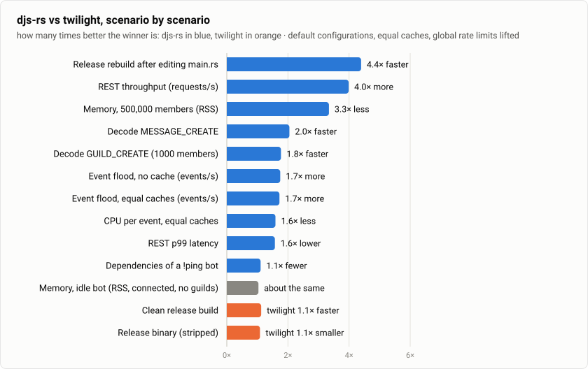
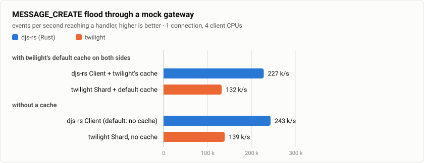
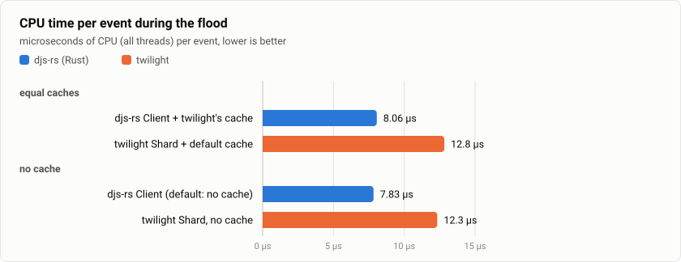
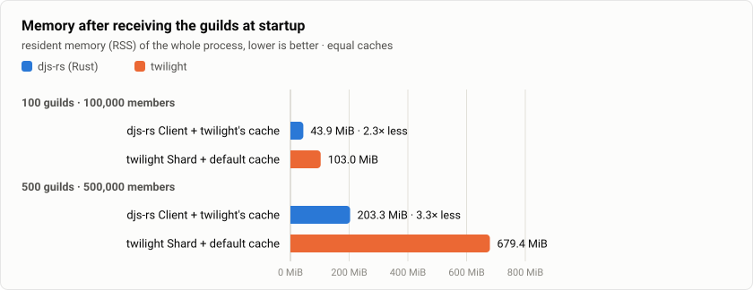
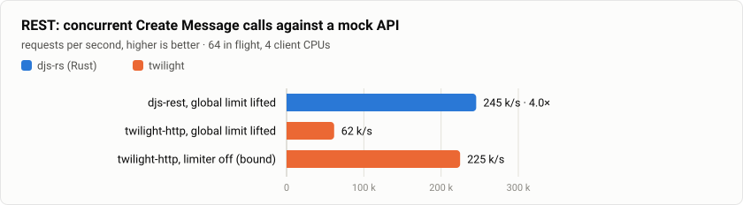
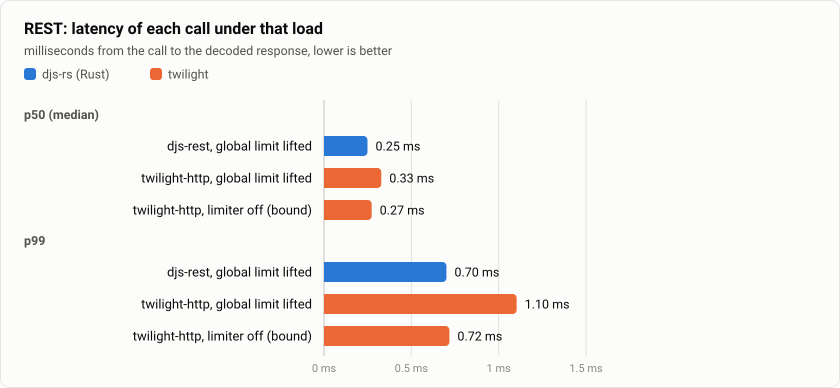
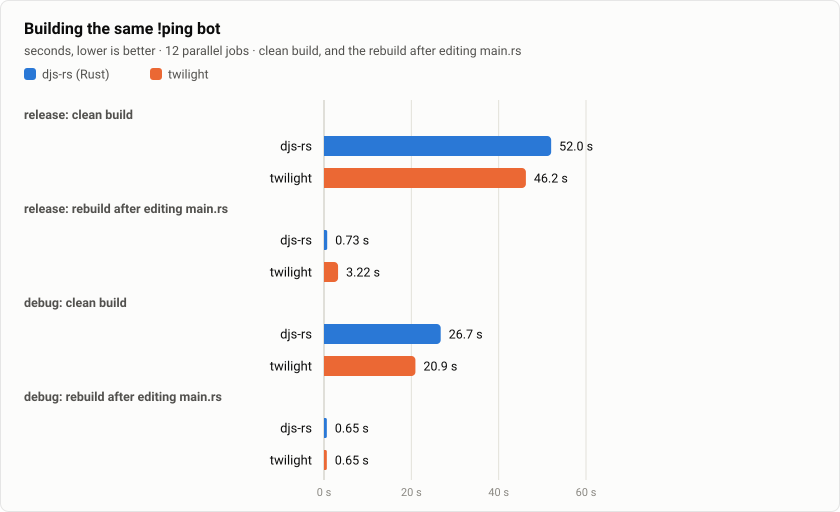
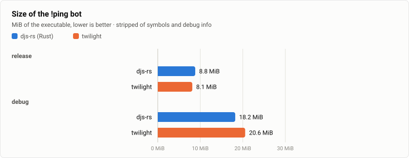

# djs-rs vs twilight

[twilight](https://github.com/twilight-rs/twilight) is a set of low-level Discord crates for
Rust, known for its speed and its small, separate building blocks: a gateway
(`twilight-gateway`), an HTTP client (`twilight-http`), a cache (`twilight-cache-inmemory`)
and the models (`twilight-model`). This page compares a bot built on djs-rs with the same bot
built on twilight 0.18, as twilight's documentation builds it, on **performance and
resources** (D-385). The numbers were measured on one machine, with the same inputs and the
same mock Discord servers for both libraries. Ease of use and API coverage are not compared
here. Every number comes from the scripts in
[`benches/vs-twilight`](../benches/vs-twilight/README.md), and anyone can re-run them
([Reproduce](#reproduce)). Where twilight does better, this page says so.

## At a glance

<!-- vs-twilight:summary:start -->
<picture>
  <source media="(prefers-color-scheme: dark)" srcset="vs-twilight/summary-dark.svg">
  
</picture>

| Scenario | djs-rs | twilight | Result |
| --- | ---: | ---: | ---: |
| Decode `MESSAGE_CREATE` | 1.50 µs | 3.08 µs | **2.0× faster** |
| Decode `GUILD_CREATE` (1000 members) | 744.34 µs | 1.32 ms | **1.8× faster** |
| Event flood, equal caches (events/s) | 227,336 | 131,959 | **1.7× more** |
| Event flood, no cache (events/s) | 242,812 | 138,874 | **1.7× more** |
| CPU per event, equal caches | 8.06 µs | 12.8 µs | **1.6× less** |
| Memory, idle bot (RSS, connected, no guilds) | 6.4 MiB | 6.6 MiB | about the same |
| Memory, 500,000 members (RSS) | 203.3 MiB | 679.4 MiB | **3.3× less** |
| REST throughput (requests/s) | 245,456 | 61,570 | **4.0× more** |
| REST p99 latency | 0.70 ms | 1.10 ms | **1.6× lower** |
| Dependencies of a `!ping` bot | 85 | 94 | **1.1× fewer** |
| Clean release build | 52.0 s | 46.2 s | twilight **1.1× faster** |
| Release rebuild after editing `main.rs` | 0.73 s | 3.22 s | **4.4× faster** |
| Release binary (stripped) | 8.8 MiB | 8.1 MiB | twilight **1.1× smaller** |
<!-- vs-twilight:summary:end -->

In short: with the same data cached, a djs-rs bot decodes Discord's events **1.8–2.0×
faster** than a twilight bot and handles **1.7× the events at 1.6× less CPU** each. Idle,
the two use the same memory; with half a million cached members djs-rs needs **3.3× less**.
Its REST client sends **4.0× more requests** than twilight's with its rate limiter, and
about as many (9 % more) as twilight with no rate limiter at all. twilight builds from
scratch faster (1.1–1.3×) and its release binary is 1.1× smaller; djs-rs **rebuilds after
an edit 4.4× faster** in release.

## How it is measured

- **The same input, byte for byte.** Every gateway payload and REST response comes from the
  generator of [`docs/VS_NODE.md`](VS_NODE.md)
  ([`payloads.rs`](../benches/vs-node/src/payloads.rs)), the same as for
  [serenity](VS_SERENITY.md). It is shaped like what Discord sends to bots, and every ID is
  unique.
- **The same mock Discord.** The mock gateway and the mock HTTP API run as separate
  processes pinned to their own CPU cores, so they never compete with the client under
  test. Their CPU use is recorded for every run (`server_cpu_ms` in
  [`results.json`](../benches/vs-twilight/results.json)).
- **twilight as its README writes a bot.** One `Shard`, a `DefaultInMemoryCache` updated
  with every event, and a task spawned per event for the handler. twilight's default cache
  keeps every resource type and 100 messages per channel; the djs-rs `Client` is given a
  cache with the same contents (`twilight_cache()` in
  [`lib.rs`](../benches/vs-node/src/lib.rs)). Both libraries are also measured without a
  cache, djs-rs's own default.
- **How twilight reaches the mocks.** `twilight-http` takes the mock API's address with its
  documented `proxy(host, true)` (plain HTTP). Its rate limiter stays on, with its proactive
  global limit (50 requests per second by default) lifted the way twilight documents,
  `RateLimiter::new(u16::MAX)`, as djs-rs's is lifted; the REST section also shows it with
  the rate limiter disabled, as a bound. The gateway
  is built without twilight's `zstd` feature, which always asks Discord for `zstd-stream`
  compression while the mock sends plain JSON; djs-rs is set to no compression as well.
- **The same CPUs and metrics.** Both clients run pinned to the same four CPU threads, and
  single-threaded decode loops to one core. CPU time and resident memory are read from
  `/proc` by the same code ([`metrics.rs`](../benches/vs-node/src/metrics.rs)).
- **Equally optimized.** The djs-rs runners and the twilight runners are built with the same
  release profile (`lto = "fat"`, `codegen-units = 1`). The two bots of the build section
  use the default profiles of a new project.
- **No network.** Every run happens in a network namespace with only a loopback interface,
  so nothing can reach Discord, even by mistake (C-108).

## 1. Decoding gateway events

How long it takes to turn one gateway payload (JSON text) into the library's typed event, on
one CPU core: djs-rs decodes into `djs-model` types, twilight into `twilight-model`'s
`GatewayEvent` with its `GatewayEventDeserializer`, as their shards do. `MESSAGE_CREATE` is
the most frequent event of a busy bot. `GUILD_CREATE` carries a whole guild at startup,
here with 1000 members.

<!-- vs-twilight:decode:start -->
<picture>
  <source media="(prefers-color-scheme: dark)" srcset="vs-twilight/decode-message-dark.svg">
  
</picture>

<picture>
  <source media="(prefers-color-scheme: dark)" srcset="vs-twilight/decode-guild-dark.svg">
  
</picture>

| Payload | Implementation | Time per payload | Payloads/s | vs twilight |
| --- | ---: | ---: | ---: | ---: |
| `MESSAGE_CREATE` | djs-rs (djs-model) | 1.50 µs | 664,764 | **2.0× faster** |
| `MESSAGE_CREATE` | twilight (twilight-model GatewayEvent) | 3.08 µs | 324,595 | baseline |
| `GUILD_CREATE` | djs-rs (djs-model) | 744.34 µs | 1,343 | **1.8× faster** |
| `GUILD_CREATE` | twilight (twilight-model GatewayEvent) | 1.32 ms | 758 | baseline |
<!-- vs-twilight:decode:end -->

- djs-rs decodes `MESSAGE_CREATE` **2.0× faster** (1.50 against 3.08 µs) and the
  1000-member `GUILD_CREATE` **1.8× faster** (0.74 against 1.32 ms), on one core, both with
  the system allocator and the same bytes.
- twilight is the fastest of the libraries compared here: serenity takes 5–6× djs-rs's
  time on the same payloads ([`VS_SERENITY.md`](VS_SERENITY.md)), twilight about twice.

## 2. Event flood through a gateway

The mock gateway sends `MESSAGE_CREATE` events as fast as one connection allows. Each event
reaches a handler of the bot (`client.on(Events::MessageCreate, …)` in djs-rs, a task
spawned for each event `shard.next_event` returns in twilight), and the cache stores what it
keeps from it.

<!-- vs-twilight:flood:start -->
<picture>
  <source media="(prefers-color-scheme: dark)" srcset="vs-twilight/flood-throughput-dark.svg">
  
</picture>

<picture>
  <source media="(prefers-color-scheme: dark)" srcset="vs-twilight/flood-cpu-dark.svg">
  
</picture>

| Implementation | Events/s (range) | vs twilight, same cache | CPU per event | vs twilight | Peak RSS |
| --- | ---: | ---: | ---: | ---: | ---: |
| djs-rs Client (default: no cache) | 242,812 (242,583–250,341) | **1.7× more** | 7.83 µs | **1.6× less** | 9.0 MiB |
| djs-rs Client + twilight's cache | 227,336 (223,865–229,237) | **1.7× more** | 8.06 µs | **1.6× less** | 8.9 MiB |
| twilight Shard, no cache | 138,874 (137,670–139,451) | baseline | 12.3 µs | baseline | 10.6 MiB |
| twilight Shard + default cache | 131,959 (130,833–132,192) | baseline | 12.8 µs | baseline | 11.5 MiB |
<!-- vs-twilight:flood:end -->

- djs-rs delivers **1.7× the events per second** with twilight's cache and spends **1.6×
  less CPU per event** (8.1 against 12.8 µs). Its memory peaks lower (8.9 against
  11.5 MiB).
- The cache costs both about the same: 6 % of djs-rs's throughput (227,336 against 242,812
  events/s without one), 5 % of twilight's (131,959 against 138,874).
- The mock gateway used about one CPU-second per run for either library, so it was never
  the limit.

## 3. Memory of the guilds a bot receives

The bot connects, receives guilds of 1000 members each (members, roles, channels, emojis,
presences) and caches them. Resident memory is measured once every guild is cached.

<!-- vs-twilight:memory:start -->
<picture>
  <source media="(prefers-color-scheme: dark)" srcset="vs-twilight/memory-dark.svg">
  
</picture>

| Guilds | Implementation | RSS | vs twilight | RSS added per member |
| --- | ---: | ---: | ---: | ---: |
| connected, no guilds | djs-rs Client + twilight's cache | 6.4 MiB | about the same | — |
| connected, no guilds | twilight Shard + default cache | 6.6 MiB | baseline | — |
| 100 guilds · 100,000 members | djs-rs Client + twilight's cache | 43.9 MiB | **2.3× less** | 391 B |
| 100 guilds · 100,000 members | twilight Shard + default cache | 103.0 MiB | baseline | 1,011 B |
| 500 guilds · 500,000 members | djs-rs Client + twilight's cache | 203.3 MiB | **3.3× less** | 412 B |
| 500 guilds · 500,000 members | twilight Shard + default cache | 679.4 MiB | baseline | 1,411 B |
<!-- vs-twilight:memory:end -->

- Connected and idle, the two are **about the same** (6.4 against 6.6 MiB).
- With guilds cached, djs-rs needs **2.3× less memory at 100 000 members and 3.3× less at
  500 000** (203 against 679 MiB): about 400 bytes per member and its user against
  1.0–1.4 KB. djs-rs keeps members and users in compact cached forms (`CachedMember`,
  `CachedUser`, D-177).

## 4. REST throughput

64 concurrent workers call Create Message (`POST /channels/{id}/messages`) against the mock
HTTP API, each in its own channel so that every request has its own rate-limit bucket. The
mock answers with a message and rate-limit headers that never run out. djs-rs's proactive
global limit (50 requests per second by default, like Discord's) is lifted, and so is
twilight's. So what is
measured is the client's own overhead: building the request, the rate limiter, HTTP and
decoding the response into a typed message.

<!-- vs-twilight:rest:start -->
<picture>
  <source media="(prefers-color-scheme: dark)" srcset="vs-twilight/rest-throughput-dark.svg">
  
</picture>

<picture>
  <source media="(prefers-color-scheme: dark)" srcset="vs-twilight/rest-latency-dark.svg">
  
</picture>

| Implementation | Requests/s | vs twilight with its limiter | p50 | p99 | CPU per request | Peak RSS |
| --- | ---: | ---: | ---: | ---: | ---: | ---: |
| djs-rest, global limit lifted | 245,456 | **4.0× more** | 0.25 ms | 0.70 ms | 14.0 µs | 12.4 MiB |
| twilight-http, global limit lifted | 61,570 | baseline | 0.33 ms | 1.10 ms | 20.2 µs | 13.0 MiB |
| twilight-http, limiter off (bound) | 224,644 | 3.6× with its limiter | 0.27 ms | 0.72 ms | 15.5 µs | 12.9 MiB |
<!-- vs-twilight:rest:end -->

- djs-rs sends **4.0× the requests per second** of twilight with its rate limiter (245,456
  against 61,570), at 1.4× less CPU per request (14.0 against 20.2 µs) and with a lower p99
  (0.70 against 1.10 ms).
- twilight's limiter, not its HTTP client, sets that number: without a rate limiter at all,
  twilight reaches 224,644 requests/s, within 9 % of djs-rs with its limiter working.
  twilight-http-ratelimiting 0.18 hands every request its permit from one actor task over
  a channel; at 61,570 requests/s twilight kept only 1.2 of its 4 CPUs busy, which points at
  that actor as the limit.
- Against the real Discord the global rate limit caps a bot long before either library is
  busy. What carries over is the CPU and memory each request costs.

## 5. Building a bot

The same `!ping` → `Pong!` bot
([`bots/djs-rs`](../benches/vs-serenity/bots/djs-rs/src/main.rs),
[`bots/twilight`](../benches/vs-twilight/bots/twilight/src/main.rs)), each in a project of
its own with default features, built with `cargo build` from an empty target directory on
every CPU. The second time is the rebuild after editing `main.rs`, which a bot author waits
for on every change.

<!-- vs-twilight:build:start -->
<picture>
  <source media="(prefers-color-scheme: dark)" srcset="vs-twilight/build-time-dark.svg">
  
</picture>

<picture>
  <source media="(prefers-color-scheme: dark)" srcset="vs-twilight/binary-size-dark.svg">
  
</picture>

| Profile | Bot | Clean build (range) | Rebuild (range) | Binary | Stripped |
| --- | ---: | ---: | ---: | ---: | ---: |
| release | djs-rs | 52.0 s (52.0 s–52.2 s) | 0.73 s (0.73 s–0.79 s) | 12.4 MiB | 8.8 MiB |
| release | twilight | 46.2 s (46.2 s–48.6 s) | 3.22 s (3.22 s–3.26 s) | 11.8 MiB | 8.1 MiB |
| debug | djs-rs | 26.7 s (26.7 s–27.9 s) | 0.65 s (0.65 s–0.93 s) | 159.1 MiB | 18.2 MiB |
| debug | twilight | 20.9 s (20.9 s–21.4 s) | 0.65 s (0.65 s–0.73 s) | 134.7 MiB | 20.6 MiB |

| Bot | Dependencies (normal, this platform) |
| --- | ---: |
| djs-rs | 85 |
| twilight | 94 |
<!-- vs-twilight:build:end -->

- **twilight builds from scratch faster:** 46.2 against 52.0 s in release, 20.9 against
  26.7 s in debug, though it pulls in more crates (94 against 85). Its stripped release
  binary is also smaller (8.1 against 8.8 MiB).
- **djs-rs rebuilds faster after an edit,** the build a bot author waits for on every
  change: 0.73 against 3.22 s in release (4.4×), because the library's code is compiled in
  its own crates rather than in the bot's (D-287–D-289). In debug both take 0.65 s.
- The two bots do not do quite the same work at startup: the twilight one caches messages
  as its README's does, the djs-rs one caches nothing (its default).

## What these numbers do and do not mean

- **They measure the libraries, not Discord.** Over the internet, network latency dominates
  REST latency, and Discord's rate limits cap how many requests a bot may send. The numbers
  show the headroom a library leaves: how many events one CPU core handles and how much
  memory a large bot needs.
- **No payload compression.** The mock gateway does not compress, so both libraries decode
  plain JSON text; in production both default to `zstd-stream`.
- **Different shapes of library.** twilight leaves the event loop, the cache updates and the
  handler tasks to the bot; djs-rs's `Client` does them. The twilight bot here is written
  the way twilight's own README writes one.
- **One machine.** A laptop CPU with frequency scaling. Repeated runs vary by a few percent,
  and each configuration's range is in `results.json`. The ratios are stable. The absolute
  numbers depend on the machine.
- **What is not compared.** Ease of use and API coverage, voice, sharding across processes,
  reliability under faults (measured against serenity in [`VS_SERENITY.md`](VS_SERENITY.md))
  and twilight's optional features (`zlib` compression, other TLS backends). Both libraries
  run with their defaults, but for the compression noted above.

## Reproduce

On Linux with Rust (stable), `unshare` (util-linux) and Node.js 22+ (for the report):

```bash
benches/vs-twilight/run.sh      # performance, 3 runs per configuration
benches/vs-twilight/build.sh    # resources: builds of the two bots (fetch their dependencies first)
node benches/vs-twilight/report.mjs benches/vs-twilight/out   # rewrites this page and results.json
```

The CPU pinning (`CLIENT_CPUS`, `SERVER_CPUS`, `DECODE_CPU`) defaults to this machine's
layout; set them to match yours. `node benches/vs-twilight/report.mjs` re-renders the page
from [`results.json`](../benches/vs-twilight/results.json) alone.
[`benches/vs-twilight/README.md`](../benches/vs-twilight/README.md) describes the harness.

## Environment

<!-- vs-twilight:environment:start -->
|  |  |
| --- | ---: |
| Date | 2026-11-17 |
| CPU | 13th Gen Intel(R) Core(TM) i7-1355U (12 threads), 15 GiB RAM, platform profile `balanced` |
| OS | Linux 7.3.3-200.fc44.x86_64 |
| Rust | `rustc 1.99.1 (58cf8f9c3 2026-10-13)`, release profile (`lto = "fat"`, `codegen-units = 1`) for the harness; the bots' own defaults for the builds |
| twilight | 0.18.0, the gateway without default features (no `zstd`: the mock sends plain JSON), everything else default |
| CPU pinning | clients on CPUs 0-3, mock servers on CPUs 4-11, decode loops on CPU 2; builds use every CPU |
| Runs | 3 per configuration (the median run is shown; decode: median of 15 rounds; builds: the faster of 2) |
| Network | none: every run inside a network namespace with only a loopback interface |
<!-- vs-twilight:environment:end -->
